**Author:** Alghisi Alessandro Paolo  
**Contact:** alexalghisi@gmail.com

# PDF Editor

[](https://github.com/alexalghisi/pdf-editor/actions/workflows/ci.yml)
[](https://github.com/alexalghisi/pdf-editor/actions/workflows/pages.yml)

**▶ Open the app: https://alexalghisi.github.io/pdf-editor/** — runs in any modern browser on desktop, Android and iPhone. No install needed.

**⬇ [Download](#download)** for Windows, macOS, Linux, Android, iPhone and iPad.

## Download

Every release ships a build for each platform. The links always point at the newest one.

| Platform                 | Download                                                                                                                                    | How to install                                                                                           |
| ------------------------ | ------------------------------------------------------------------------------------------------------------------------------------------- | -------------------------------------------------------------------------------------------------------- |
| Windows 10 / 11          | [PDF-Editor-Windows-x64.exe](https://github.com/alexalghisi/pdf-editor/releases/latest/download/PDF-Editor-Windows-x64.exe)                 | Portable, nothing to install. Double-click; on the SmartScreen notice choose **More info → Run anyway**. |
| macOS (Apple Silicon)    | [PDF-Editor-macOS-Apple-Silicon.zip](https://github.com/alexalghisi/pdf-editor/releases/latest/download/PDF-Editor-macOS-Apple-Silicon.zip) | Unzip, move to Applications, then right-click the app and choose **Open** the first time.                |
| macOS (Intel)            | [PDF-Editor-macOS-Intel.zip](https://github.com/alexalghisi/pdf-editor/releases/latest/download/PDF-Editor-macOS-Intel.zip)                 | Same as above.                                                                                           |
| Linux                    | [PDF-Editor-Linux-x86_64.AppImage](https://github.com/alexalghisi/pdf-editor/releases/latest/download/PDF-Editor-Linux-x86_64.AppImage)     | `chmod +x PDF-Editor-Linux-x86_64.AppImage`, then run it.                                                |
| Android                  | [PDF-Editor-Android.apk](https://github.com/alexalghisi/pdf-editor/releases/latest/download/PDF-Editor-Android.apk)                         | Open the file on the phone and allow installing from this source.                                        |
| iPhone and iPad          | [PDF-Editor-iOS-unsigned.ipa](https://github.com/alexalghisi/pdf-editor/releases/latest/download/PDF-Editor-iOS-unsigned.ipa)               | Unsigned build of the native app. Sign and install it with AltStore or Sideloadly, or run it from Xcode. |
| iOS Simulator            | [PDF-Editor-iOS-Simulator.zip](https://github.com/alexalghisi/pdf-editor/releases/latest/download/PDF-Editor-iOS-Simulator.zip)             | Unzip and drag `PDFEditor.app` onto a running simulator.                                                 |
| Any browser, self-hosted | [PDF-Editor-Web.zip](https://github.com/alexalghisi/pdf-editor/releases/latest/download/PDF-Editor-Web.zip)                                 | Static site. Serve the folder under `/pdf-editor/`.                                                      |

The builds are not signed with a paid developer certificate, which is why Windows, macOS and iOS ask for the extra confirmation described above.

## Native app for iPhone and iPad

`ios-native/` is a separate app written in Swift with SwiftUI and PDFKit. It does not use React Native.

| Start screen                                                            | Editing a line                                                               | iPad                                                                       |
| ----------------------------------------------------------------------- | ---------------------------------------------------------------------------- | -------------------------------------------------------------------------- |
| 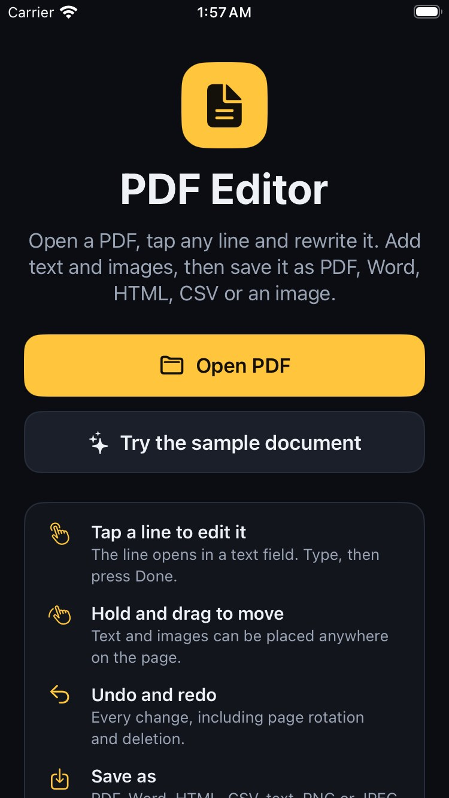 | 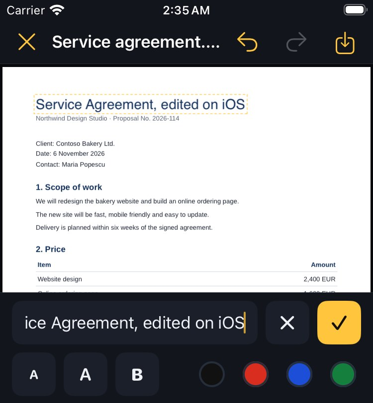 | 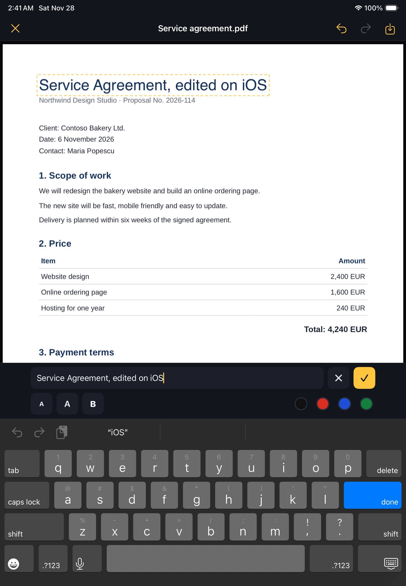 |

- **Tap a line** to rewrite it. The text field opens above the keyboard with size and colour controls.
- **Hold and drag** any text or image to move it. Add new text or a photo from the toolbar.
- **Undo and redo** every change, including rotating and deleting pages.
- **Save as** PDF, Word, HTML, CSV, text, PNG or JPEG through the system share sheet.
- Opens PDFs from Files, from other apps ("Open in…") and keeps a list of recent documents.

To run it on your own iPhone: open `ios-native/PDFEditor.xcodeproj` in Xcode 16 or newer, pick your Apple ID under _Signing & Capabilities_, connect the phone and press Run. `xcodebuild test -project ios-native/PDFEditor.xcodeproj -scheme PDFEditor -destination 'platform=iOS Simulator,name=iPhone 16'` runs the 40 unit tests.

How it differs from the web engine: the native app covers the original line and draws the new text over it when the PDF is saved, so the old glyphs stay underneath in the file. The web and desktop apps rewrite the content stream itself. Bringing the content-stream rewriter to Swift is on the [improvement list](docs/IMPROVEMENTS.md).

## Desktop app

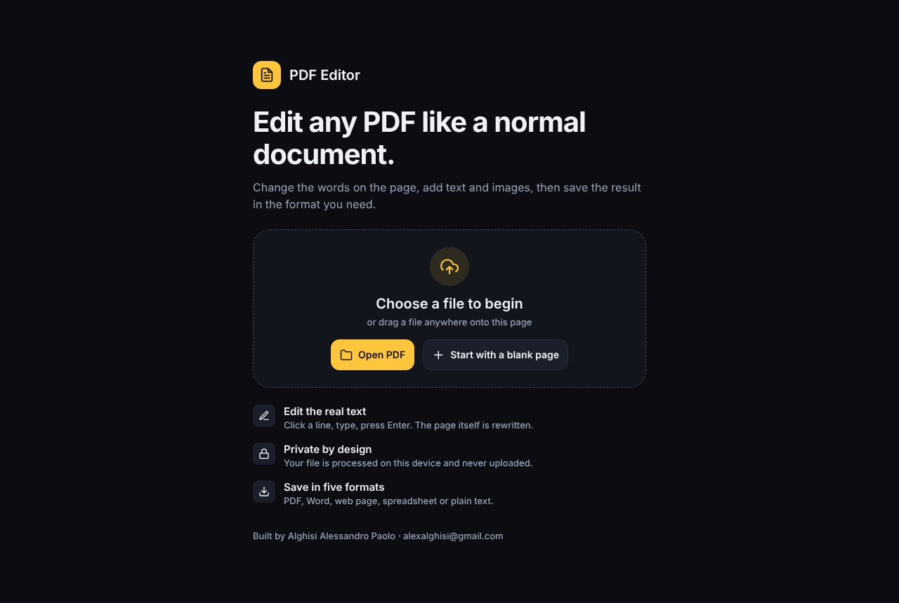

`desktop/` wraps the web build in Electron for Windows, macOS and Linux. It works offline and serves the app from a local port on `127.0.0.1`.

```bash
npm run build:web
cd desktop && npm install && npm start
```

A professional React Native PDF editor that loads, parses, and **rewrites the PDF content stream**. Text and images are first-class nodes in the document AST. Mutations are not flattened annotations.

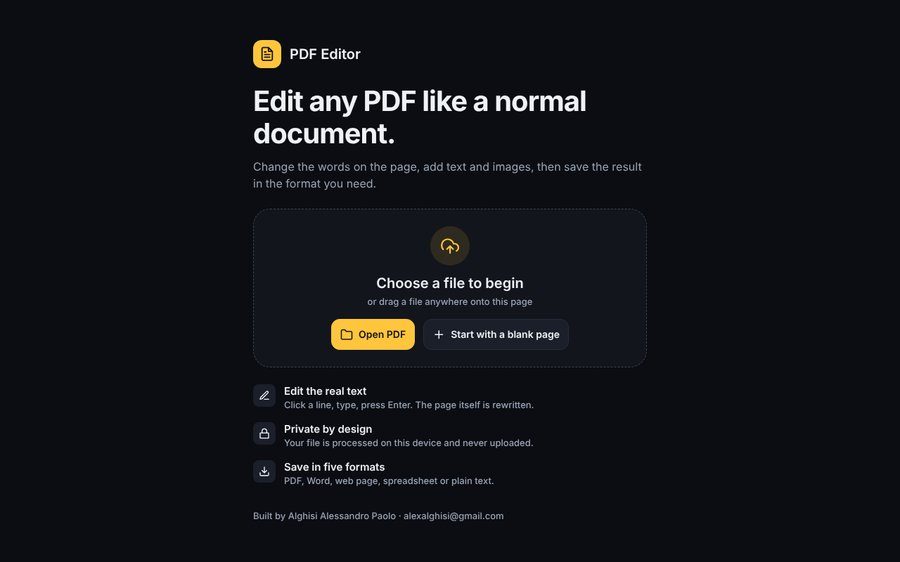

| Desktop browser                           | Phone browser                                                          |
| ----------------------------------------- | ---------------------------------------------------------------------- |
| 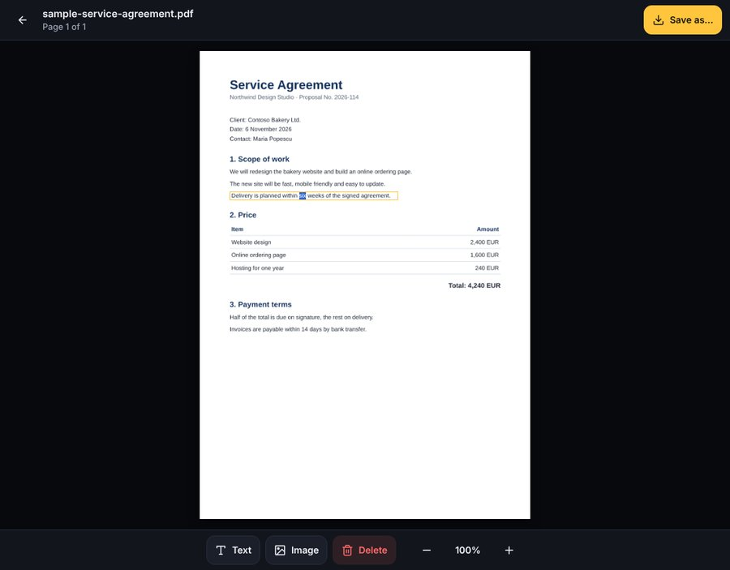 | 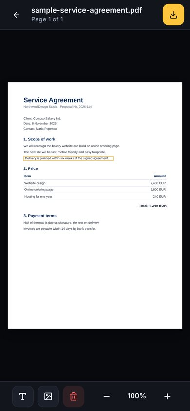 |

## Edit the text of any PDF like a document

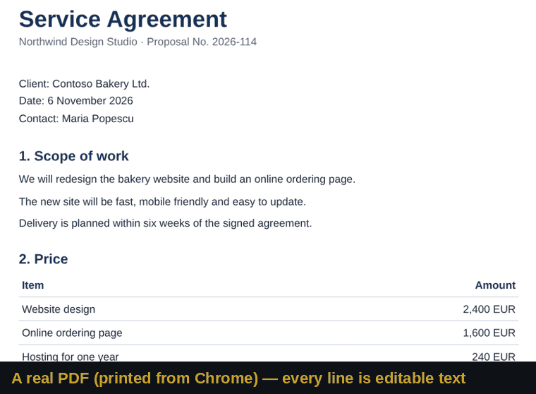

The GIF is the live web app on a real PDF printed from Chrome ([sample-service-agreement.pdf](docs/sample-service-agreement.pdf) — open it in the app and try it):

1. **Click a line** to select it, **click it again** to edit. It opens with the whole line selected, so typing overwrites it.
2. Inside the line it behaves like a text field in a document: click or use the arrow keys to place the caret, **Shift+arrows / double-click / drag** to select a word, **Backspace/Delete**, **Ctrl/Cmd+A**, copy and paste.
3. **Enter** (or clicking elsewhere) writes the new text into the PDF; **Esc** cancels.
4. **Save as…** PDF, Word, HTML, CSV, text, PNG or JPEG.

To open a file, press **Open PDF** or drag it anywhere onto the start screen.

The page you see is the real PDF, re-rendered by pdf.js after each edit — the text is rewritten in the page content stream, not painted over with an annotation. On a phone it works the same way with taps and the on-screen keyboard.

The project is built with TDD, Clean Architecture, and strict TypeScript. Page rasterization runs in a JSI/Expo native module (PDFKit on iOS, `PdfRenderer` on Android) so large documents never block the JS thread.

## Architecture

```
pdf-editor/
├── App.tsx
├── index.ts
├── modules/pdf-native-engine/          # JSI native rasterizer
│   ├── ios/PdfNativeEngineModule.swift # PDFKit
│   └── android/.../PdfNativeEngineModule.kt
└── src/
    ├── domain/                         # Enterprise rules — no I/O
    │   ├── entities/                   # PdfDocument, PdfPage, nodes
    │   ├── valueObjects/               # Rect, RgbColor, PdfObjectId, Matrix
    │   ├── services/PdfAstEngine.ts    # Port (hexagonal)
    │   └── errors/
    ├── application/                    # Use cases
    │   ├── ports/                      # FileSystem, PageRenderer
    │   └── useCases/                   # Load, Save, Mutate
    ├── infrastructure/                 # Adapters
    │   ├── pdf/                        # Content-stream parser + rewriter
    │   ├── native/                     # TurboModule spec + fallback
    │   ├── fs/                         # Expo file system
    │   └── di/container.ts
    └── presentation/                   # UI — no PDF object-graph knowledge
        ├── store/editorStore.ts        # Zustand
        ├── canvas/                     # Pinch-zoom, drag, inline edit
        ├── screens/
        └── theme/
```

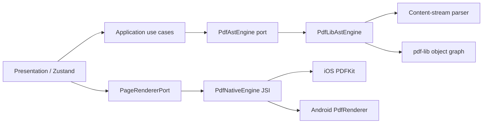

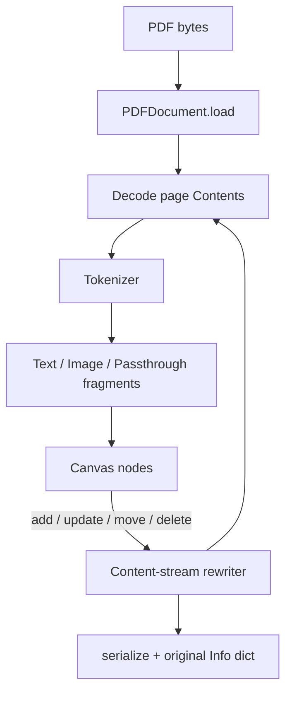

### Why this split

| Layer          | Responsibility                                                                         |
| -------------- | -------------------------------------------------------------------------------------- |
| Domain         | Immutable document model in ISO 32000 user space. No React, no pdf-lib.                |
| Application    | Orchestrates ports. Returns `Result<T, PdfDomainError>`.                               |
| Infrastructure | Parses operators (`Tj`, `TJ`, `Do`, `cm`, …), rewrites streams, embeds fonts/XObjects. |
| Native         | Rasterizes a page off-thread. Never owns the AST.                                      |
| Presentation   | Converts PDF space ↔ screen space. Drag, pinch, inline text.                           |

UI components never import `pdf-lib`. The store talks only to use cases.

## Capabilities

- Load and parse existing PDFs (catalog, pages, Info dictionary).
- Extract **text** (`BT`/`Tj`/`TJ`) and **images** (`Do` XObjects) with page-space bounds.
- Add, update, delete, and move text and images by rewriting the page content stream.
- Preserve vector art as passthrough operator groups.
- Untouched operators are written back as they were, so a page that is only partly edited keeps the rest of its content operator for operator — including pages drawn under a flipped or scaled CTM, as browsers and office suites produce them.
- Lossless save that restores title, author, creator, and producer.
- **Save as** PDF, Word (`.docx`), web page (`.html`, every line at its PDF position), spreadsheet (`.csv`, table cells become columns, UTF-8 with BOM for Excel) or plain text, or the current page as a PNG or JPEG image (rendered at 3× for sharp text). On the web the file downloads; on iOS/Android it opens the share sheet.

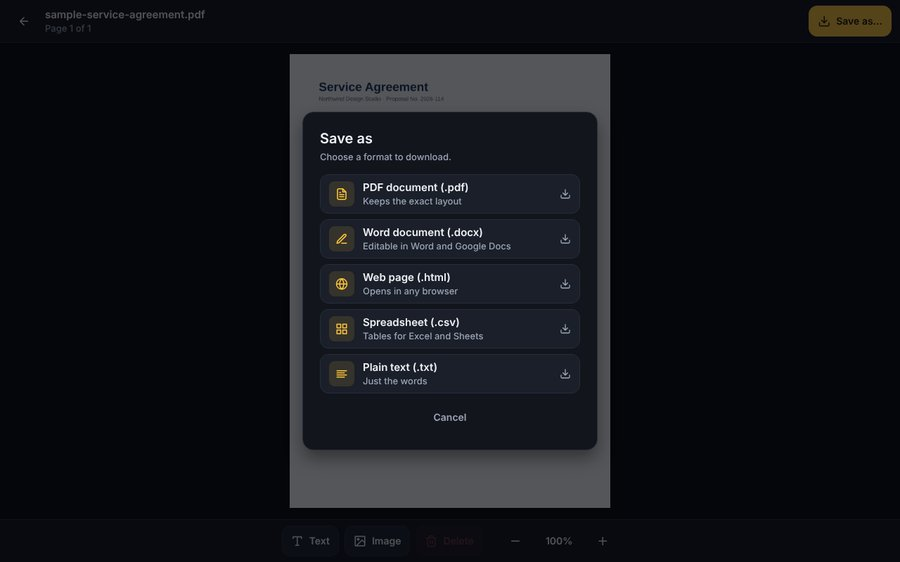

- Interactive canvas: tap to select, drag to move, tap a selected text again to edit it in place (Enter saves, Esc cancels), pinch or `−`/`+` to zoom, click the percentage to reset it.
- Live page preview of the edited document: pdf.js on web, `PdfNativeEngine` in a dev client / release build.

### Known limitations

- Fonts are swapped, not synthesized: retyped text that the original subset font cannot show is drawn in Liberation Sans (metric-compatible with Arial/Helvetica).

- Existing text is read through each font's `ToUnicode` CMap, `Encoding` and `Differences`, so PDFs from Chrome, Word, LibreOffice and LaTeX show and edit as real text (including `Identity-H` two-byte fonts). An edit keeps the document's own font when that font has every glyph; otherwise the run switches to a bundled Unicode font (Liberation Sans, SIL OFL), so Romanian (ș ț ă î â), Greek, Cyrillic and symbols always render.
- Composite fonts that ship no `ToUnicode` map carry glyph ids only; their text can be moved or deleted, and retyping it writes the new text in the Unicode font.
- Text drawn inside form XObjects is rendered but not yet exposed as editable nodes.

## Tests

| Command             | What it checks                                                                                                                                       |
| ------------------- | ---------------------------------------------------------------------------------------------------------------------------------------------------- |
| `npm test`          | Unit and component tests: domain, PDF engine, store, screens and controls.                                                                           |
| `npm run e2e`       | The built web app in Chrome: text editing and export, toolbar, page navigation, drag and drop, broken files, and layout from 320 px to 1920 px wide. |
| `npm run typecheck` | Strict TypeScript.                                                                                                                                   |

Run `npm run build:web` before `npm run e2e`. The layout suite writes a screenshot of every screen and size to `e2e-screenshots/`.

Planned work and the history of changes are in [docs/IMPROVEMENTS.md](docs/IMPROVEMENTS.md).

## Setup

```bash
cd pdf-editor
npm install
npm test
npm run typecheck
npx expo start
```

A development build is required for the native rasterizer:

```bash
npx expo prebuild
npx expo run:ios
# or
npx expo run:android
```

Expo Go still edits the AST. The canvas draws a paper surface and node overlays when the JSI module is absent.

### Run in the browser (no Xcode required)

The engine is `pdf-lib`, so the whole editor runs unchanged on the web. A build is
published to GitHub Pages and works on any device — including an iPhone — straight
from the browser:

**Live app:** https://alexalghisi.github.io/pdf-editor/

```bash
npm run build:web   # exports a static bundle to ./dist
npx expo start --web
```

On web, document/image pickers hand back `blob:`/`data:` URIs, and a save is
delivered as a browser download of the edited PDF. Pages are rasterized by
pdf.js in a module worker (`public/pdf.worker.min.mjs`, copied from
`node_modules` on `npm install`). Every push to `main` rebuilds and redeploys the
site through the `Deploy web app` workflow.

### Scripts

| Command                                  | Purpose                                                                                                                                    |
| ---------------------------------------- | ------------------------------------------------------------------------------------------------------------------------------------------ |
| `npm test`                               | Jest + Testing Library (TDD suite)                                                                                                         |
| `npm run test:coverage`                  | Coverage with thresholds                                                                                                                   |
| `npm run typecheck`                      | `tsc --noEmit`, strict + `noUncheckedIndexedAccess`                                                                                        |
| `npx expo start`                         | Metro bundler                                                                                                                              |
| `npm run build:web`                      | Static web export to `./dist`                                                                                                              |
| `npm run e2e`                            | Edits the sample PDF in the built app with Chrome (desktop + phone viewport) and checks the saved PDF, Word, CSV, PNG and JPEG; runs in CI |
| `python3 scripts/record-demo.py`         | Re-records `docs/editor-demo.gif` from the built app                                                                                       |
| `python3 scripts/capture-screenshots.py` | Re-captures the desktop and phone screenshots                                                                                              |

## TDD map

Tests were written before the engine implementation:

1. `src/infrastructure/pdf/contentStream/__tests__/tokenizer.test.ts`
2. `src/infrastructure/pdf/contentStream/__tests__/parser.test.ts`
3. `src/infrastructure/pdf/__tests__/PdfAstEngine.parse.test.ts`
4. `src/infrastructure/pdf/__tests__/PdfAstEngine.mutate.test.ts`

Fixtures are hand-rolled ISO 32000 files (`buildFixturePdf`), not objects that pdf-lib already understands.

## Native contract (JSI / TurboModule)

```ts
type NativePdfEngineSpec = {
  getPageCount(path: string): Promise<number>;
  getPageSize(
    path: string,
    pageIndex: number,
  ): Promise<{ width: number; height: number }>;
  renderPage(
    path: string,
    pageIndex: number,
    scale: number,
  ): Promise<{
    uri: string;
    width: number;
    height: number;
  }>;
};
```

Decoded bitmaps are written to a temp PNG and released. The JS thread only receives a URI.

## State

Zustand holds the open `PdfDocument`, selection, page index, and zoom. Mutations go through `MutateDocument`, which snapshots the engine session so the UI always reads a fresh immutable graph.

## License

Private. All rights reserved unless otherwise agreed with the author.
